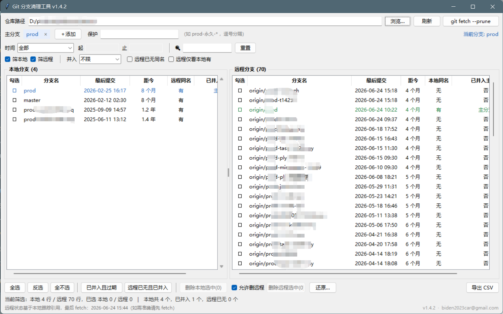

# Git 分支清理工具

**v1.8.0**　作者：283365011@qq.com

[**⬇ 下载 Windows 版**](https://github.com/carbin1930/git-branch-manager/releases/latest)　·　免安装单文件　·　零第三方依赖

---

## 这个工具解决什么问题

分支攒到几十上百个之后，清理变成一件很烦的事：

- **看不出来哪个该删。** `git branch -a` 一屏几百行，只有名字和一个星号，不知道哪个是半年前建的、哪个昨天还在改。
- **判断一个分支要跑好几条命令。** 想删它得先确认三件事：多久没提交了（`git log -1`）、远程还有没有（`git ls-remote`）、代码是否已合并进主分支（`git branch --merged`）。几十个分支挨个比对，一个下午就没了。
- **删错了找不回来。** `git branch -D` 之后那些 commit 变成不可达对象，默认两周后 `git gc` 一跑就彻底消失。等有人问"那个分支的代码还在吗"，已经晚了。

这个工具把这三件事摆到一屏：**左边本地分支、右边远程分支**，每行直接标出最后提交时间、远程有没有同名、是否已经并入主分支。勾选、批量删，删之前自动留一份能长期恢复的备份。

> 适合：个人项目定期清理、接手别人留下的仓库、团队仓库里几十个 `prod-xxx` 工单分支需要归档。



## 核心能力

| 能力 | 说明 |
|---|---|
| **双列对照** | 本地 / 远程分支并排显示，各自可排序、独立筛选 |
| **时间筛选** | 「超 3 个月 / 半年 / 1 年 / 2 年未提交」，直接圈出该清理的那批 |
| **合并判定** | 判断分支是否已并入 `prod`/`master`，删除前就知道会不会丢代码 |
| **带保护的批量删除** | 当前分支、主分支、白名单、worktree 占用自动跳过 |
| **删除可还原** | 删前记录 SHA + 建 `refs/gbm-backup/*` 备份点，gc 之后也能找回 |
| **路径记忆** | 打开过的仓库进下拉框，切换项目点一下即可 |
| **导出 CSV** | 当前筛选视图导出，UTF-8 BOM，Excel 打开中文不乱码 |

---

## 快速开始

**方式一（推荐）** 从 [Releases](https://github.com/carbin1930/git-branch-manager/releases/latest) 下载 `GitBranchManager.exe`，双击运行。

免安装、不需要 Python 环境，单文件 11.4 MB，唯一的外部依赖是 `git`（必须在 PATH 中）。

> exe 未做代码签名，首次运行若被 Windows SmartScreen 拦截，点「更多信息」→「仍要运行」。

**方式二** 源码运行：双击 `启动.vbs`（无控制台窗口），或命令行 `pythonw git_branch_manager.pyw`。

> `.pyw` 不一定关联了解释器，直接双击 `git_branch_manager.pyw` 可能只弹出「选择打开方式」，源码方式请走 `启动.vbs`。

启动后界面是空的：路径框会预填上次用过的仓库，但**不会自动连接**，点「刷新」才真正读取。下拉框里是最近打开过的 10 个仓库。

### 配置与日志在哪里

| 运行方式 | `config.json` / `branch-delete.log` 位置 |
|---|---|
| exe | 与 `GitBranchManager.exe` **同级目录** |
| 源码 | 与 `git_branch_manager.pyw` 同级目录 |

两种方式的配置互不共享。移动 exe 时如果想把配置带走，把这两个文件一起移过去。

### 重新打包

```bat
python -m PyInstaller --noconfirm --clean --onefile --noconsole ^
  --name GitBranchManager --version-file version_info.txt ^
  --distpath dist --workpath build git_branch_manager.pyw
```

产物在 `dist\GitBranchManager.exe`。`version_info.txt` 给 exe 写入文件属性（产品名、版本、版权），右键「属性 → 详细信息」能看到，升级版本时记得同步改里面的 `filevers` / `FileVersion`。

打包后可用 `GitBranchManager.exe --diag` 生成 `diag.txt`，确认 `app_dir`、`config_path`、Tk 版本是否正确（排查"配置写不进去"时最有用）。

---

## 界面说明

```
仓库路径 [ D:/repo/example ▾ ] [浏览…] [刷新] [git fetch --prune]
主分支 [prod ×] [master ×] [＋添加]   保护 [通配符]          当前分支: feature-x
时间 [超1年未提交▾] 起[____] 止[____]  |  🔍[分支名，支持 * 通配] [重置]
☑筛本地 ☑筛远程  |  并入[不限▾]  ☐远程已无同名  ☐远程仅看本地有
┌──── 本地分支 (24) ────┬──── 远程分支 (120) ────┐
│ ☐ 分支名 最后提交 距今 远程同名 已并入 │ ☐ 分支名 最后提交 距今 本地同名 已并入 │
└───────────────────────┴─────────────────────────┘
[全选][反选][全不选] | [已并入且过期][远程已无且已并入] | [删除本地选中(n)] ☐允许删远程 [删除远程选中] [还原…] [导出CSV]
状态：当前筛选 12 行，已选 3 行 | 本地共 24 个，已并入 6 个，远程已无 4 个
      远程状态基于本地跟踪引用，最后 fetch：2026-11-06 09:48
```

窗口默认 1200×720，可自由缩放；列宽可拖动调整，下次启动会记住。

状态栏右下角的 `v1.6.0 · 邮箱 · 关于` 可以点击，弹出关于框：版本、作者、开源许可、仓库地址、配置文件与日志的实际路径，以及「打开程序目录」按钮。

### 关于

「关于」对话框里带项目仓库和最新版下载地址，点一下就跳转。如果你是从别处拿到这个 exe、想找源码或看有没有新版本，从状态栏右下角进最方便。

### 悬停提示

按钮和筛选条件都有提示，鼠标停 0.5 秒会浮出来：

- 「已并入且过期」会告诉你**当前阈值算到哪一天**——它跟随上面的「时间」筛选，不是固定一年
- 「并入」筛选会说明它**同时作用于本地和远程两张表**
- 两个删除按钮会列出各自会自动跳过哪些分支

不确定某个按钮干什么，停一下就有说明。

### 关键概念

| 列 | 含义 |
|---|---|
| 最后提交 | 分支尖端提交的 **committerdate**（非 author date） |
| 距今 | 距离今天多久没提交过 |
| 远程同名 / 本地同名 | 按**同名分支是否存在**判定，不看 upstream 配置 |
| 已并入主分支 | `是(prod)` = 分支尖端是 prod 的祖先，删除不丢代码；`否` = 有 prod 没有的提交；`—` = 未设置主分支 |

**时间筛选的语义是「多久没动过」，不是「最近多久」。** 选「超 1 年未提交」= 只显示最后提交早于一年前的分支，正好对应要清理的那批旧分支。默认「全部」。

「自定义」是区间筛选（起始 ~ 截止），日期格式 `YYYY-MM-DD`。

### 按分支名筛选

顶部搜索框输入即过滤，本地和远程两张表同时生效：

| 输入 | 含义 |
|---|---|
| `prod` | 包含 prod 的分支（子串，忽略大小写） |
| `prod-*` | 以 `prod-` 开头，`*` 匹配任意字符 |
| `prod-?otel*` | `?` 匹配单个字符 |
| `prod wip` | 空格分隔 = 同时包含多个关键字 |

筛完点「全选」，**只会勾选当前可见的行**——被过滤掉的分支不受影响，不会误伤。比如输入 `prod-0904-*` 一次圈出整批，全选、删除，就是批量清理。

### 主分支

- 首次打开仓库时自动识别存在的 `prod`、`master`（最多两个），也可点「＋添加」加入 `main`、`release` 等。
- 支持多个，**判定取并集**：并入任意一个即算已并入，列里显示命中的名字。
- 主分支不可删除，且无法添加不存在的分支。

### 保护白名单

顶部「保护」输入框，支持 `*` 通配、逗号分隔，例如：

```
release-*, hotfix-*
```

命中白名单的分支即使被勾选也会在删除时自动跳过并说明原因。

---

## 删除与还原

### 本地删除

1. 在左表勾选分支（点第一列方框，或选中行按空格）。
2. 点「删除本地选中(n)」。
3. 确认框逐条列出分支名、最后提交时间、是否已并入；**未并入的行标红**，且必须额外勾选「我已确认」才能点确认。
4. 批量执行 `git branch -D -- <name1> <name2> ...`，完成后自动刷新。

> 删除是批量走的：备份点用一次 `git update-ref --stdin` 建好，删除用一条命令带全部名字，30 个分支也是秒级完成。个别分支失败时（比如被 worktree 占用）会逐个复核，单独报告原因。
>
> 整个过程在后台线程执行，状态栏右侧有进度条，界面不会卡住。

自动跳过（勾选也没用）：当前检出分支、所有主分支、命中保护白名单的分支、裸仓库。

### 远程删除（默认关闭）

1. 勾选「允许删远程」。
2. 在右表**勾选**分支（和左表一样点第一列方框，也支持空格键）。
3. 点「删除远程选中(n)」，**必须手工输入 `DELETE`** 才能提交。

删除范围按危险程度分档：

| 情况 | 处理 |
|---|---|
| 已并入主分支 | 直接可删，输入 `DELETE` 即可 |
| 未并入，但本地有同名副本 | 行标红 + 提示「删除后仍可从本地重新推送」，需勾选确认 |
| 未并入，本地也没有 | 行标红 + 深红警告「提交可能彻底丢失，没有地方可以找回」，需勾选确认 |
| 主分支本身、命中保护白名单 | 不可删 |

> 不再要求本地有同名分支：只要提交已在主分支里，远程分支就是冗余的。
>
> 未并入的分支**也可以删**，但要同时满足两个条件：勾选「我已确认：删除未并入主分支的远程分支，相关提交可能彻底丢失」+ 手工输入 `DELETE`。确认框的「已并入」列会显示 `否 · 有本地副本` / `否 · 无本地副本`，方便逐个判断。

### 删除后如何恢复

工具提供了两层保障，**不用记 SHA 也能还原**：

1. 删除前把分支尖端 SHA 追加写入 `branch-delete.log`
2. 删除前把同一个 SHA 挂到一个备份 ref：`refs/gbm-backup/<时间戳>/<分支名>`

第 2 步很关键：只要还有 ref 指向这些 commit，`git gc` 就不会回收它们，**过多久都能还原**。没有备份 ref 的话，不可达对象默认两周后就会被清理。

点主界面右下角的「还原…」，会列出本仓库删过的所有分支：

| 状态 | 含义 |
|---|---|
| 可还原 | commit 还在本地，可以直接恢复 |
| 已存在 | 同名分支又回来了，不需要还原 |
| 对象已回收 | commit 已被 gc 清掉，只能从其他 clone 里找回 |
| 已还原 | 本次会话刚恢复过 |

勾选后点「还原选中」，执行 `git branch <分支名> <完整SHA>`，成功后自动删掉对应的备份 ref 并刷新主列表。同名分支只显示最近一次删除记录。

也可以手工还原（不依赖本工具）：

```bash
git branch <分支名> <完整SHA>
```

> 备份 ref 位于 `refs/gbm-backup/`，不在 `refs/heads/` 下，所以不会出现在分支列表里，也不影响 `git branch` 的常规输出。想看有哪些：

```bash
git for-each-ref refs/gbm-backup
```

清理历史备份点（确认不再需要后）：

```bash
git for-each-ref --format="delete %(refname)" refs/gbm-backup | git update-ref --stdin
```

---

## 日志与多仓库

`branch-delete.log` 每行一条，**用制表符（tab）分隔**，共 6 段：

```
时间 ⇥ 仓库路径 ⇥ 分支名 ⇥ 完整SHA ⇥ 并入情况 ⇥ 动作
```

`动作` 为 `DELETE` 或 `RESTORE`。之所以用 tab 而不是 `|`：git 分支名允许包含 `|`，用竖线分隔会把列拆错。

日志全局只有一份，所有仓库的记录混在一起，每条都带仓库绝对路径。还原窗口按当前仓库过滤，**不同仓库不会互相干扰**——即使两个仓库有同名分支也不会串。路径比较已处理 `D:/a/b` 与 `D:\a\b`、大小写、结尾分隔符、符号链接 / SUBST 虚拟盘符这些差异。

需要注意的边界：

- **仓库被移动或改名**：旧记录按旧路径保存，新路径下看不到它们。但 `refs/gbm-backup/*` 备份点跟着仓库走，仍会以「（仅备份点）」形式出现在列表里，照样能还原。
- **日志会一直增长**：每个被删的分支一行。想清理直接删文件即可（只丢失"删除时间/是否已并入"这些元信息，不影响备份点）。
- **每个 exe 副本各有一份日志**：日志在 exe 同级目录，把 exe 复制到别处带不走历史。

**日志丢失也能还原**：还原窗口的数据来源是「日志记录 ∪ 仓库内的备份点」。只要 commit 对象还在，即使 `branch-delete.log` 被删、或者仓库被拷到另一台机器，备份点里的分支仍会以「（仅备份点）」出现，可以直接还原。

### 格式兼容性承诺

`branch-delete.log` 和 `refs/gbm-backup/*` 是**跨版本长期有效**的数据。程序迭代不会让旧记录失效，具体承诺：

- **日志只追加，不改已有字段。** 新增信息只能加在第 6 段之后，前 6 段的顺序和含义不变。
- **旧格式永远能读。** 早期版本用过 `时间 | 仓库 | 分支名 | SHA | 并入情况` 这种竖线分隔的 5 段格式，现在的程序仍能正确解析。
- **解析失败的行跳过，不中断。** 手工编辑过或编码损坏的行会被忽略，不影响同一文件里其他记录的读取。
- **备份 ref 命名固定。** `refs/gbm-backup/<时间戳>/<分支名>` 的层级结构不变，新版本才能识别旧版本留下的备份点。
- **记录只增不删。** 还原操作也是追加一条 `RESTORE` 记录，不会重写或抹掉历史行。

之所以定这条约束：日志和备份点是「删错了能找回来」的唯一依据。如果某次迭代改了格式导致旧记录读不出来，等于把用户以前删的分支永久弄丢了——这比功能少一个严重得多。

---

## 文件

| 文件 | 说明 |
|---|---|
| `git_branch_manager.pyw` | 主程序源码（单文件，全部逻辑） |
| `启动.vbs` | 源码方式的无窗口启动入口 |
| `docs/screenshot.png` | 界面截图 |
| `config.json` | 首次运行自动生成：仓库历史、主分支、筛选条件、白名单、列宽、导出目录 |
| `branch-delete.log` | 删除留痕，首次删除时生成（追加写） |
| `error.log` | 仅在程序异常时生成，用于排查 |
| `需求文档.md` | 需求规格 |

## 已知边界

- **裸仓库**：只能浏览，本地删除按钮禁用。
- **detached HEAD**：当前分支显示 `(detached)`，不做当前分支保护判断。
- **未配置远程**：右表为空并提示。
- **`refs/remotes/origin` 这类顶层残留 ref** 会被过滤，不会出现只有 `origin` 没有分支名的行。
- **分支被其他 worktree 占用**：删除前就会拦下，并提示占用它的 worktree 路径（`git branch -D` 本身也会拒绝）。
- **当前分支判定是实时的**：点删除时会重新读一次 `git symbolic-ref --short HEAD`，不会用打开程序时的旧值。
- **远程状态基于本地跟踪引用**：状态栏显示 `.git/FETCH_HEAD` 的最后时间，需要准确数据时先点 `git fetch --prune`。
- **超时**：普通命令 30 秒，`git push --delete` 90 秒，超时按失败计入结果。
- **中文分支名**：所有 git 调用带 `core.quotepath=false` + UTF-8，不会出现 `\344\270\255` 转义。

---

## 版本历史

| 版本 | 变更 |
|---|---|
| **1.8.0** | 分支名筛选支持 `*` / `?` 通配与空格分隔多关键字；搜索框加宽并带占位提示 |
| 1.7.0 | 按钮与筛选项增加悬停提示；「已并入且过期」的提示会动态显示当前阈值 |
| 1.6.0 | 新增「关于」对话框：版本、作者、许可、仓库地址、配置与日志路径，一键打开程序目录 |
| 1.5.1 | 作者邮箱恢复为 283365011@qq.com |
| 1.5.0 | 仓库路径改为可下拉的历史记录（最近 10 个，自动去重）；README 重构并加入界面截图 |
| 1.4.2 | 作者信息更新；版本号统一显示在标题栏与状态栏 |
| 1.4.1 | 提示里的分支名改为每行一条（原先顿号挤成一段）；确认框按内容自适应高度 |
| 1.4.0 | 未并入主分支的远程分支改为「强提醒 + 双重确认后放行」；确认框按「本地有无副本」分级警告 |
| 1.3.0 | 批量删除（30 个分支 25s → 1.5s）、状态栏进度条、当前分支实时复核、worktree 占用提前提示、日志丢失后可从备份点还原 |
| 1.2.0 | 远程分支表支持勾选；远程删除放宽为「已并入主分支即可删」；快捷勾选同时作用于两表 |
| 1.1.0 | 删除还原（留痕 + 备份 ref）、窗口缩小到 1200×720、筛选栏改为两行 |
| 1.0.0 | 首版：双列展示、时间/并入/远程筛选、主分支管理、保护白名单、批量删除、CSV 导出、配置持久化 |

> 版本号规则：新增功能递增次版本号，修 bug / 样式调整递增修订号。版本常量在 `git_branch_manager.pyw` 顶部的 `APP_VERSION`，同时显示在窗口标题和状态栏右下角。
