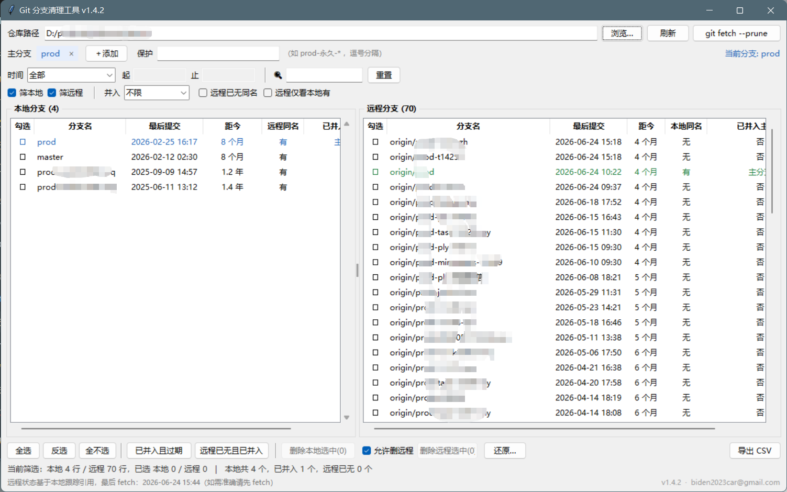

# Git Branch Manager

[中文](README.md) ｜ **English**

**v1.8.1**　Author: 283365011@qq.com

[**⬇ Download for Windows**](https://github.com/carbin1930/git-branch-manager/releases/latest)　·　Single portable exe　·　No dependencies

> The application UI is in Chinese. Button labels are quoted below in Chinese with an English gloss — they appear in the same order on screen.

---

## The problem it solves

Once a repository accumulates dozens or hundreds of branches, cleaning up becomes tedious:

- **You can't tell which ones are safe to delete.** `git branch -a` prints hundreds of lines with nothing but a name and an asterisk. There's no indication of which branch was created six months ago and which one was touched yesterday.
- **Checking a single branch takes several commands.** Before deleting you need three facts: how long since the last commit (`git log -1`), whether a remote copy still exists (`git ls-remote`), and whether the work is already merged into your main branch (`git branch --merged`). Doing that by hand for a few dozen branches eats an entire afternoon.
- **Deleting is irreversible.** After `git branch -D` those commits become unreachable objects, and `git gc` reclaims them after two weeks by default. By the time someone asks "is that branch still around?", it's gone.

Git Branch Manager puts all three answers on one screen: **local branches on the left, remote branches on the right**, each row showing the last commit date, whether a remote counterpart exists, and whether the branch is already merged. Select, delete in bulk, and every deletion is backed up so you can restore it later.

> Typical use: periodic cleanup of personal projects, taking over a repository someone else left behind, or archiving a team repo full of `prod-xxx` ticket branches.



## Features

| Feature | Description |
|---|---|
| **Side-by-side view** | Local and remote branches in parallel, each sortable and filterable independently |
| **Age filter** | "Older than 3 / 6 / 12 / 24 months" narrows the list to the branches actually worth cleaning |
| **Merge detection** | Shows whether a branch is already contained in `prod`/`master` — you know before deleting whether code would be lost |
| **Guarded bulk delete** | The current branch, main branches, whitelisted patterns, and branches checked out in other worktrees are skipped automatically |
| **Restorable deletes** | Every deletion records the SHA and pins a `refs/gbm-backup/*` ref, so it survives `git gc` |
| **Remembered repositories** | Recently opened repos stay in a dropdown — switching projects is one click |
| **CSV export** | Exports the current filtered view as UTF-8 BOM CSV, opens cleanly in Excel |

---

## Quick start

**Option 1 (recommended)** — grab `GitBranchManager.exe` from [Releases](https://github.com/carbin1930/git-branch-manager/releases/latest) and double-click it.

Portable, no Python required, 11.4 MB single file. The only external requirement is `git` on your `PATH`.

> The exe is not code-signed, so Windows SmartScreen may show "Windows protected your PC". That's the default policy for unknown publishers with low download counts, not a virus verdict. Click **More info → Run anyway**, or right-click the exe → Properties → check **Unblock**.

**Option 2** — run from source: double-click `启动.vbs`, or `pythonw git_branch_manager.pyw`.

The window opens empty on purpose: the path box may be prefilled with the last repository, but nothing is loaded until you press **刷新** (Refresh). The dropdown holds the 10 most recently opened repositories.

### Where config and logs live

| How you run it | `config.json` / `branch-delete.log` location |
|---|---|
| exe | Same directory as `GitBranchManager.exe` |
| source | Same directory as `git_branch_manager.pyw` |

The two modes do not share configuration. Move the files alongside the exe if you want to keep your history.

### Rebuilding the exe

```bat
python -m PyInstaller --noconfirm --clean --onefile --noconsole ^
  --name GitBranchManager --version-file version_info.txt ^
  --distpath dist --workpath build git_branch_manager.pyw
```

Output lands in `dist\GitBranchManager.exe`. `version_info.txt` writes the Windows file properties (product name, version, copyright) visible under right-click → Properties → Details; bump `filevers` / `FileVersion` there when you release.

`GitBranchManager.exe --diag` writes a `diag.txt` next to the exe with the resolved `app_dir`, `config_path` and Tk version — useful when configuration refuses to save.

---

## Interface

```
仓库路径 [ D:/repo/example ▾ ] [浏览…] [刷新] [git fetch --prune]
主分支 [prod ×] [master ×] [＋添加]   保护 [patterns]          当前分支: feature-x
时间 [older than 1 year ▾] from[____] to[____]  |  🔍[branch name, * supported] [reset]
☑filter local ☑filter remote  |  merged[any ▾]  ☐no remote copy  ☐remote has local
┌──── local branches (24) ────┬──── remote branches (120) ────┐
│ ☐ name | last commit | age | remote | merged │ ☐ name | last commit | age | local | merged │
└─────────────────────────────┴───────────────────────────────┘
[select all][invert][none] | [merged & stale][no remote & merged] | [delete local (n)] ☐allow remote [delete remote] [restore…] [export CSV]
Status: 12 rows shown, 3 selected | 24 local total, 6 merged, 4 without remote
        Remote status is based on local tracking refs, last fetch: 2026-11-06 09:48
```

The window opens at 1200×720 and is resizable. Column widths are draggable and persisted.

### Column meanings

| Column | Meaning |
|---|---|
| Last commit | The **committerdate** of the branch tip (not the author date) |
| Age | How long since that commit |
| Remote / Local counterpart | Whether a **same-named** branch exists — upstream configuration is ignored |
| Merged | `Yes(prod)` means the branch tip is an ancestor of `prod`, so deleting it loses no code; `No` means it carries commits `prod` doesn't have; `—` means no main branch is configured |

**The age filter means "hasn't been touched in", not "recently active".** Choosing "older than 1 year" shows only branches whose last commit predates one year ago — exactly the set you want to clean.

The custom option filters an explicit date range (`YYYY-MM-DD`).

### Main branches

- On first opening a repository, existing `prod` and `master` branches are detected automatically (up to two). Use **＋添加** (Add) to include `main`, `release`, etc.
- Multiple main branches are supported and evaluated as a union: a branch merged into any of them counts as merged, and the column shows which ones matched.
- Main branches cannot be deleted, and you cannot add a branch that doesn't exist.

### Protection whitelist

The **保护** (Protect) field accepts `*` wildcards, comma-separated:

```
release-*, hotfix-*
```

Branches matching the whitelist are skipped during deletion even if selected, with the reason shown in the result.

### Filtering by branch name

The search box filters as you type, applying to both tables:

| Input | Meaning |
|---|---|
| `prod` | Substring match, case-insensitive |
| `prod-*` | Wildcard — `*` matches any characters |
| `prod-?otel*` | `?` matches a single character |
| `prod wip` | Space-separated terms must **all** match |

After filtering, **Select all** only ticks the rows currently visible — branches filtered out are untouched. That's the fast path for bulk cleanup: type `prod-0904-*`, select all, delete.

---

## Deleting and restoring

### Local branches

1. Tick branches in the left table (click the checkbox column, or select a row and press Space).
2. Click **删除本地选中(n)** (Delete selected local).
3. The confirmation dialog lists each branch with its last commit date and merge status. **Unmerged rows are highlighted in red** and require an extra acknowledgment checkbox.
4. Deletion runs as a single `git branch -D -- <name1> <name2> ...`, then the view refreshes.

> Deletion is batched: backup refs are created with one `git update-ref --stdin` call and the delete is one command with all names, so 30 branches finish in about a second. Branches that fail individually (for example, checked out in another worktree) are re-checked and reported separately.
>
> Everything runs on a background thread behind a progress indicator, and the UI is locked with an overlay while it works, so you can't change filters or selections mid-operation.

Automatically skipped, even when selected: the currently checked-out branch, all main branches, whitelisted branches, and bare repositories.

### Remote branches (off by default)

1. Tick **允许删远程** (Allow remote deletion).
2. Tick branches in the right table.
3. Click **删除远程选中(n)** — you must type `DELETE` by hand to confirm.

Confirmation is graded by how much you'd lose:

| Situation | Handling |
|---|---|
| Already merged into a main branch | Delete directly; typing `DELETE` is enough |
| Not merged, but a local copy exists | Row highlighted; "you can still push it back from local" — requires the acknowledgment checkbox |
| Not merged, and no local copy | Row in deep red: "these commits could be lost for good" — requires the acknowledgment checkbox |
| A main branch, or whitelisted | Cannot be deleted |

> A local counterpart is no longer required: if the commits already live in the main branch, the remote branch is redundant.
>
> Unmerged branches **can** still be deleted, but only by both ticking the acknowledgment box and typing `DELETE`. The merged column shows `No · local copy exists` / `No · no local copy` so you can judge case by case.

### Restoring a deleted branch

Two layers of protection, so **you never need to remember a SHA**:

1. The branch tip SHA is appended to `branch-delete.log`.
2. The same SHA is pinned to a backup ref: `refs/gbm-backup/<timestamp>/<branch name>`.

Step 2 is what matters: as long as a ref points at those commits, `git gc` won't reclaim them, **no matter how much time passes**. Without the backup ref, unreachable objects are collected after two weeks by default.

Click **还原…** (Restore) in the bottom-right to list everything deleted from this repository:

| State | Meaning |
|---|---|
| Restorable | The commit object is still present locally |
| Already exists | A branch with that name is back; nothing to do |
| Object collected | The commit was garbage-collected; recover from another clone |
| Restored | Restored earlier in this session |

Select and click **还原选中**, which runs `git branch <name> <full sha>`, removes the corresponding backup ref, and refreshes the list. Only the most recent deletion of a given name is shown.

You can also restore by hand:

```bash
git branch <name> <full-sha>
```

> Backup refs live under `refs/gbm-backup/`, not `refs/heads/`, so they never appear in branch listings. To inspect them:

```bash
git for-each-ref refs/gbm-backup
```

To clean up old backup refs once you're sure you don't need them:

```bash
git for-each-ref --format="delete %(refname)" refs/gbm-backup | git update-ref --stdin
```

---

## Log format and multiple repositories

`branch-delete.log` holds one record per line, **tab-separated**, in six fields:

```
timestamp ⇥ repository path ⇥ branch name ⇥ full SHA ⇥ merged status ⇥ action
```

`action` is either `DELETE` or `RESTORE`. Tabs are used instead of `|` because Git branch names may legitimately contain a pipe character.

There is a single log file shared by all repositories; every record carries the absolute repository path, and the restore dialog filters by the current repository, so two repos with identically named branches never collide. Path comparison handles `D:/a/b` vs `D:\a\b`, letter case, trailing separators, and symlinked or SUBST drive letters.

Worth knowing:

- **If a repository is moved or renamed**, older records still point at the old path and won't show up there. The backup refs travel with the repository though, and appear as "(backup only)" entries that can still be restored.
- **The log grows forever**: one line per deleted branch. Delete the file whenever you like — you only lose metadata such as deletion time and merge status, not the backup refs.
- **Each copy of the exe has its own log**, since the log sits next to the executable.

**Lost the log?** The restore dialog reads the union of the log and the backup refs inside the repository. As long as the commit objects exist, entries still appear as "(backup only)" even if `branch-delete.log` was deleted or the repository was copied to another machine.

### Format compatibility promise

`branch-delete.log` and `refs/gbm-backup/*` are long-lived, cross-version data. Future releases will not break old records:

- **Fields are only ever appended.** New information goes after the sixth field; the first six keep their order and meaning.
- **Old formats stay readable.** Early versions used a five-field format separated by `|`, and the current parser still handles it.
- **Unparsable lines are skipped**, not fatal. Hand-edited or encoding-damaged lines are ignored without affecting the rest of the file.
- **Backup ref naming is fixed**: `refs/gbm-backup/<timestamp>/<branch name>`.
- **Records are append-only.** A restore appends a `RESTORE` line rather than rewriting history.

The reason is simple: the log and the backup refs are the *only* way to recover a branch deleted by mistake. A format change that made old records unreadable would permanently destroy that safety net.

---

## Files

| File | Purpose |
|---|---|
| `git_branch_manager.pyw` | The entire application in one file |
| `启动.vbs` | Launcher for source mode without a console window |
| `version_info.txt` | Windows file properties (product name, version, copyright) |
| `docs/screenshot.png` | Screenshot used in this README |
| `config.json` | Created on first run: recent repositories, main branches, filters, whitelist, column widths, export directory |
| `branch-delete.log` | Deletion history, created on first delete (append-only) |
| `error.log` | Created only when the app hits an exception |
| `需求文档.md` | Requirements spec (Chinese) |

## Known limitations

- **Bare repositories**: browse only; local deletion is disabled.
- **Detached HEAD**: the current branch shows `(detached)` and current-branch protection doesn't apply.
- **No remote configured**: the right table is empty with a hint.
- **Stray refs such as `refs/remotes/origin`** (no branch name) are filtered out.
- **Branches checked out in another worktree** are caught before deletion, and the occupying worktree path is shown (`git branch -D` refuses them too).
- **The current branch is re-read at delete time**, not taken from when you opened the app — switching branches in another terminal won't cause a misjudgment.
- **Remote status comes from local tracking refs.** The status bar shows the timestamp of the last `.git/FETCH_HEAD`; run `git fetch --prune` for accurate data.
- **Timeouts**: 30 seconds for ordinary commands, 90 seconds for `git push --delete`; a timeout counts as a failure.
- **Non-ASCII branch names** work: every git call uses `core.quotepath=false` with UTF-8, so names never appear as `\344\270\255` escapes.

---

## Version history

| Version | Changes |
|---|---|
| **1.8.1** | "Merged only" filter no longer lists main branches; UI locked during delete/fetch |
| 1.8.0 | Branch filter supports `*` / `?` wildcards and space-separated terms; wider search box with placeholder |
| 1.7.0 | Tooltips on buttons and filters; the "merged & stale" tooltip shows the current cutoff |
| 1.6.0 | About dialog: version, author, license, repository URL, config/log paths, open-app-folder button |
| 1.5.1 | Author email reverted to 283365011@qq.com |
| 1.5.0 | Repository path became a dropdown with the 10 most recent repos; README restructured with screenshot |
| 1.4.2 | Author info updated |
| 1.4.1 | Branch names in messages listed one per line; confirmation dialog auto-sizes to content |
| 1.4.0 | Unmerged remote branches changed to "strong warning + double confirmation"; graded by whether a local copy exists |
| 1.3.0 | Batched deletion (30 branches: 25s → 1.5s), progress bar, live current-branch re-check, worktree hints, restore from backup refs |
| 1.2.0 | Checkboxes on the remote table; remote delete relaxed to "merge into main is enough"; quick-select applies to both tables |
| 1.1.0 | Delete/restore with logging and backup refs; window shrunk to 1200×720; filter bar split into two rows |
| 1.0.0 | First release: parallel view, age/merge/remote filters, main branch management, whitelist, bulk delete, CSV export, persisted config |

> Versioning: new features bump the minor version, bug fixes and styling bump the patch version. The constant lives in `APP_VERSION` at the top of `git_branch_manager.pyw` and is shown in the title bar and the bottom-right corner.
